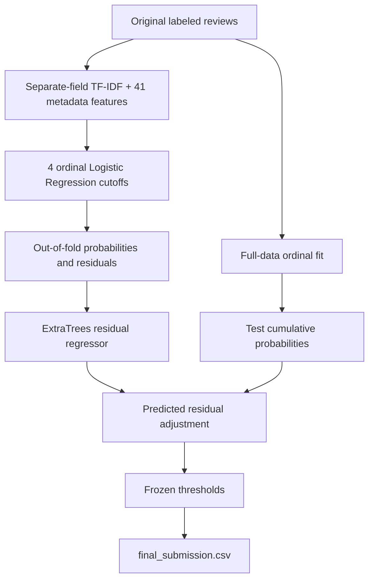

# Music Review Rating Prediction — Kaggle Midterm

**Kaggle username:** eshaanagarwal06  
**Best public leaderboard macro-F1:** **0.56669** (Submission 7; final cleaned-code resubmission pending)  
**Final model:** Ordinal Logistic Regression + ExtraTrees residual correction

The task was to predict ratings from **1 to 5** for music reviews using review text and release/reviewer metadata. The dataset contains **447,583 reviews**: **367,583 labeled reviews** and **80,000 reviews with ratings to predict**. The competition uses **macro-averaged F1**, so performance on less common ratings matters as much as performance on the majority class. I developed the final model by moving from a text-only SVM baseline through engineered metadata, ordinal classification, and nonlinear correction. All models used classical machine learning, without deep learning or boosting.

## 1. Data Exploration

I inspected the dataset schema, rating distribution, missing values, repeated identifiers, and relationships that could inform feature engineering. The inputs include a review summary, full review text, genres, reviewer/album/artist IDs, review time, and helpful-vote counts.

The labeled ratings were imbalanced:

| Rating | Labeled reviews | Share |
|---|---:|---:|
| 1 | 39,353 | 10.7% |
| 2 | 23,476 | 6.4% |
| 3 | 44,933 | 12.2% |
| 4 | 80,708 | 22.0% |
| 5 | 179,113 | 48.7% |

Most text and metadata fields were populated; missing summary/review text was handled during preprocessing. I also found **25 groups of identical normalized review text with conflicting ratings**. These were potential ambiguities to investigate, not necessarily incorrect labels.

A more consequential pattern was the uneven repetition of identifiers. There were about **195,891 reviewers**, **28,570 albums**, and **12,162 artists** in the labeled set. In an initial holdout, only **44.2%** of reviews had a previously observed reviewer, compared with **97.5%** for albums and **99.3%** for artists. This suggested that rating-history information could help, especially for albums and artists, but that the model still needed a strong text-based foundation for unseen reviewers. The large five-star majority, meanwhile, made **macro-F1 rather than accuracy** the appropriate selection criterion.

## 2. Feature Extraction / Engineering

### Text features

I used **TF-IDF with word unigrams and bigrams** to represent the summary, review body, and genres. TF-IDF discounts very frequent terms while retaining words and phrases that distinguish reviews; its sparse representation works well with linear classifiers on a dataset of this size. It is a strong **classical baseline**, not a universally best alternative to deep learning. I also experimented with character n-grams, larger vocabularies, supervised n-gram selection, and NB-weighted text features, but those alternatives did not consistently improve the selected model.

The final model fits **separate TF-IDF vectorizers** for the three fields rather than placing everything into one text column:

| Field | Maximum vocabulary | Relative weight | Reason |
|---|---:|---:|---|
| Summary | 20,000 | 1.0 | Short, concentrated opinion/sentiment cues |
| Review text | 90,000 | 1.0 | Longer text with greater vocabulary and phrase variety |
| Genres | 3,000 | 0.5 | Smaller, more repetitive field; useful context but less direct sentiment |

These limits and weights came from the **selected configuration after extensive feature and hyperparameter experiments**. They also constrain vocabulary size and memory use; I do not claim that each exact cutoff is a universal optimum. The final vectorizers use `min_df=2`, sublinear term frequency, Unicode accent normalization, and `float32` sparse matrices.

### Structured metadata: 41 features

I engineered **41 features** to capture information that TF-IDF may miss:

| Group | Features | Why included |
|---|---:|---|
| Reviewer, album, artist rating histories | 24 | Counts, smoothed averages, variation, and proportions of ratings 1–5 capture historical tendencies |
| Genre and reviewer–genre histories | 4 | Capture genre-level expectations and whether a reviewer rates particular genres differently |
| Static review characteristics | 13 | Summary/review length, punctuation, genre count, helpful votes, review date, and missing-time indicators provide context |

The feature groups were selected through experimentation, not assumed to be useful: in an initial matched ablation, removing reviewer features decreased macro-F1 by about **0.0038**, and removing album/artist features decreased it by about **0.0045**. Genre-preference features had a smaller measured contribution. I used **smoothed statistics** to avoid treating ratings from one or two past reviews as reliable averages.

Because rating-history features depend on the target, I used **four-fold cross-fitting**: each labeled review's target-derived features were calculated from other folds, not from its own score. For test reviews, these statistics were calculated using all available labeled reviews. The 41 features were standardized, clipped to limit extreme values, and given a final model weight of **1.4**, selected during tuning.

## 3. Model Creation and Assumptions

### From initial models to ordinal classification

I began with **TF-IDF + Linear SVM**, then added metadata and tested reviewer–album/artist **matrix-factorization** blends. I also compared standard multinomial classification, alternative text models (including **NB-SVM**), ensembles, and different ordinal decision rules. These experiments established that text was the strongest starting point, metadata helped, and modeling rating order produced the largest subsequent improvement.

I selected **ordinal Logistic Regression** because ratings have a natural order: confusing 4 with 5 is different from confusing 1 with 5. Instead of one five-class model, I fit four independent binary Logistic Regression classifiers for:

- `Score > 1`
- `Score > 2`
- `Score > 3`
- `Score > 4`

Their cumulative probabilities are made nonincreasing and converted into five class probabilities. Because the four classifiers have **separately fitted coefficients**, this approach **does not impose the proportional-odds assumption** of a single shared-slope ordinal logit. Logistic Regression also works directly with the sparse TF-IDF features. The final regularization setting was **`C=4`, `solver="liblinear"`**, selected through development experiments.

### Nonlinear residual correction

A linear ordinal model cannot directly capture every interaction between rating history, review characteristics, and uncertainty in its own predictions. I therefore trained an **ExtraTrees regressor** to estimate the residual:

`residual = actual rating − out-of-fold expected rating`

Its **53 inputs** are the 41 metadata features plus 12 ordinal-output features: four cumulative probabilities, five class probabilities, expected rating, prediction entropy, and the margin between the two largest class probabilities. ExtraTrees averages many randomized trees and can capture nonlinear patterns in this small, dense second-stage feature space. Compared with a conventional Random Forest, its randomized split points offer a different computation/bias–variance trade-off. NB-SVM, meanwhile, was an alternative *text classifier*, not an equivalent nonlinear residual regressor. The ExtraTrees **residual approach won the relevant development comparisons**, which was the decisive reason for choosing it.

The resulting residual adjusts the five probabilities using an **exponential probability tilt**, followed by four development-selected thresholds to obtain the final rating.



**Leakage control:** For residual training, I generated four **outer out-of-fold ordinal predictions**, refitting the TF-IDF vocabulary, metadata scaler, and ordinal models inside each fold. Target-dependent metadata in each outer training fold was itself **cross-fitted in four inner folds**. This prevents the baseline prediction used to create a review's residual from being trained on that review's rating. For the final Kaggle fit, I used **all labeled reviews**, with no permanent validation holdout.

## 4. Model Tuning

I ran multiple rounds of **large-scale experiments** rather than tuning only the final configuration. Early tests compared text representations and the contribution of metadata. Later tests compared ordinal vs. multiclass models, combined vs. separate text fields, regularization `C`, metadata weights, probability offsets/thresholds, and ensembles. An additional tuning run used a **new random split** and compared **50 candidates** by cross-validation before checking the selected configuration on a holdout.

The overnight architecture research then tested nonlinear stackers, tree depth/leaf-size trade-offs, training-set scale, matrix-factorization additions, NB-SVM, character n-grams, and residual correction. It used **294,066 fit reviews (A)**, **25,730 development reviews (B)**, and a **47,787-review locked audit (C)**. The selected ExtraTrees residual variant scored **0.56660 macro-F1 on B**, and its settings were fixed before the audit on C. Many recorded configurations were blends or decision-rule variants, not separate full model trainings.

The final parameters were:

| Component | Selected settings |
|---|---|
| Text | Summary 20k, review 90k, genre 3k; weights `1 / 1 / 0.5` |
| Ordinal model | Four Logistic Regressions, `C=4`, metadata weight `1.4` |
| Cross-fitting | Four outer folds; four inner folds for fold-specific metadata |
| Residual model | ExtraTrees, `800` trees, `min_samples_leaf=5`, `max_features=0.8` |
| Probability adjustment | Tilt strength `1.2`, sigma `0.85` |
| Rating thresholds | `[0.45, 0.575, 0.575, 0.575]` (frozen from development) |

I selected these settings based on the best observed **development performance**, while limiting dependence on any single validation score. The thresholds were optimized for **macro-F1**, where the usual 0.5 cutoff need not be optimal. I did not retune them using Kaggle test labels or after inspecting the locked audit.

## 5. Model Evaluation / Performance

**Macro-F1** averages the F1 score of each of the five rating classes equally, so a model cannot obtain a good score simply by overpredicting the common five-star class.

### Kaggle public leaderboard

| Submission | Main change | Public macro-F1 |
|---|---|---:|
| 1 | TF-IDF + Linear SVM baseline | 0.46871 |
| 2 | Add 41 engineered metadata features | 0.48666 |
| 3 | Add matrix-factorization blend | 0.49214 |
| 4 | Ordinal Logistic Regression + offsets | 0.54117 |
| 5 | Separate-field ordinal TF-IDF + thresholds | 0.55918 |
| 6 | Ordinal ensemble (`C=2` / `C=4`) | 0.56046 |
| **7** | **Ordinal `C=4` + ExtraTrees residual correction** | **0.56669** |
| Final cleaned-code rerun | Same selected architecture | *Pending resubmission* |

The public score improved by **0.09798 macro-F1 points** from the original baseline to Submission 7. The largest jump came from exploiting the ordered target, while the residual stage provided a smaller final improvement.

### Local audit and error analysis

The selected residual model achieved **0.56732 macro-F1** on the locked local audit, with **66.98% accuracy** and **0.396 mean absolute rating error**. This was approximately **+0.00702 macro-F1** over the corresponding ordinal baseline on that audit. These are **local audit results, not Kaggle scores**.

| Rating | Audit F1 |
|---|---:|
| 1 | 0.750 |
| 2 | 0.340 |
| 3 | 0.385 |
| 4 | 0.513 |
| 5 | 0.849 |

Ratings **2 and 3** were the clearest weaknesses. They had fewer labeled examples and appeared harder to distinguish from neighboring ratings using their language. About **83.5% of erroneous audit predictions were off by only one star**, consistent with the difficulty of fine-grained distinctions rather than wholesale reversals. These findings motivated later adjacent-rating specialist experiments, but they did **not** reliably beat the selected baseline.

## 6. Struggles / Issues / Open Questions

**Memory and runtime.** Training large tree ensembles and repeated complete ordinal pipelines was expensive on my **16 GB RAM** machine. This limited the practical number and scale of experiments. I controlled memory through sparse `float32` text matrices, the 53-feature dense residual representation, limited ExtraTrees parallelism, and deliberate feature/leaf-size settings.

**Separating real gains from validation overfitting.** After macro-F1 passed about **0.56**, many changes improved scores by less than one percentage point. Reusing the same holdout made small gains hard to trust, but changing splits made raw scores less directly comparable. I used matched comparisons, cross-validation, fresh development splits, and a frozen final audit to reduce this risk, while recognizing that extensive search can still overfit model-selection decisions.

**Middle ratings.** Two- and three-star reviews remained difficult because they were less frequent and their language often overlapped with adjacent ratings. With more time, I would run larger, better-controlled experiments and examine which phrases and reviewer/album contexts distinguish ratings **2 vs. 3** and **3 vs. 4**, then test targeted improvements on fresh evaluation data.

## Reproducing the Final Submission

Place the original `train.csv` and `test.csv` alongside `final_submission.py`:

```text
CS506_Midterm_Eshaan_Agarwal/
├── README.md
├── requirements.txt
├── .gitignore
├── final_submission.py
├── train.csv          # local only; not committed to GitHub
└── test.csv           # local only; not committed to GitHub
```

Run:

```bash
python -m pip install -r requirements.txt
python final_submission.py
```

The script trains from the original CSVs. It uses all labeled reviews for the final models and writes **`final_submission.csv`** next to the script. The fixed random seed is `20261107`. Full training can be memory- and time-intensive; the script does not report a validation score on the competition test set.


## References and AI Use

- Frank, E., & Hall, M. (2001). [*A simple approach to ordinal classification*](https://researchcommons.waikato.ac.nz/entities/publication/ce0009f5-92fa-4113-b8b2-7ac929cfd32c). Background for reducing ordered labels to binary threshold tasks; my implementation uses independent Logistic Regression models.
- Geurts, P., Ernst, D., & Wehenkel, L. (2006). [*Extremely randomized trees*](https://doi.org/10.1007/s10994-006-6226-1). *Machine Learning, 63*, 3–42. Basis for the ExtraTrees residual model.
- Scikit-learn documentation: [TF-IDF Vectorizer](https://scikit-learn.org/stable/modules/generated/sklearn.feature_extraction.text.TfidfVectorizer.html), [Logistic Regression](https://scikit-learn.org/stable/modules/generated/sklearn.linear_model.LogisticRegression.html), [ExtraTrees Regressor](https://scikit-learn.org/stable/modules/generated/sklearn.ensemble.ExtraTreesRegressor.html), and [F1 score](https://scikit-learn.org/stable/modules/generated/sklearn.metrics.f1_score.html). Used for implementation details and evaluation definitions.

I used AI tools, as permitted by the assignment, to help research unfamiliar methods, develop and refine experimental code, interpret results, and improve the reproducibility and documentation of the final pipeline. Model choices and reported performance are based on the experiments and submissions described above. No external training dataset or pretrained model is required by the final submission script.
