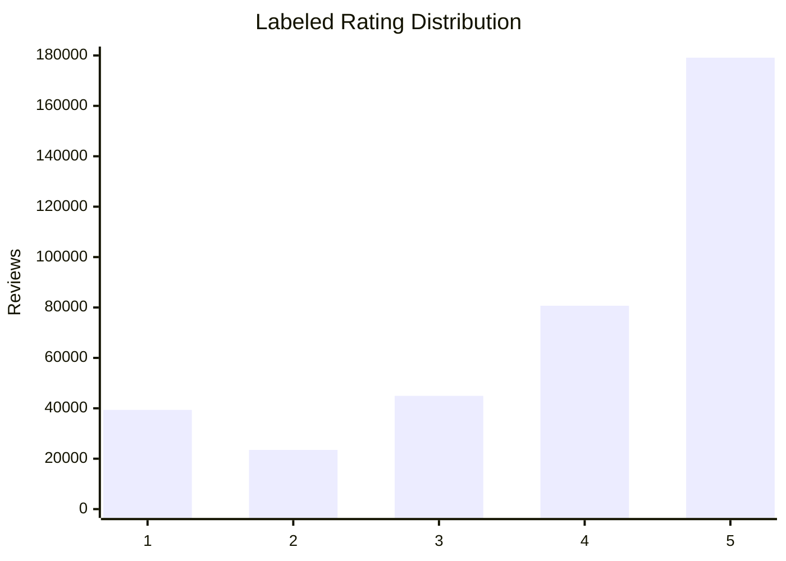
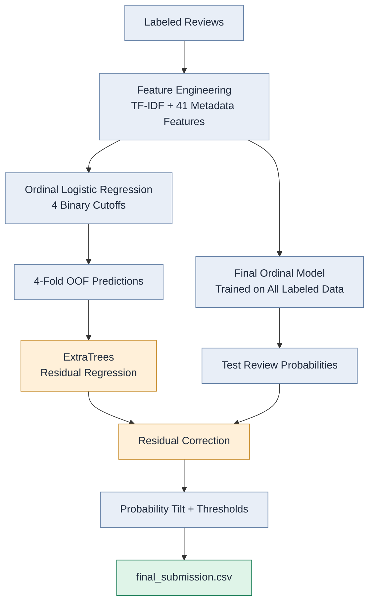

# Music Review Rating Prediction — Kaggle Midterm

**Kaggle username:** `eshaanagarwal06`  
**Final public leaderboard macro-F1:** **0.56589**
**Final private leaderboard macro-F1:** **0.57268**
**Final model:** Ordinal Logistic Regression + ExtraTrees residual correction

The goal of this project was to predict **1–5 music review ratings** from review text and metadata. The dataset contains **447,583 reviews**: **367,583 labeled reviews** and **80,000 unlabeled reviews** whose ratings had to be predicted for Kaggle submission. Because the competition was scored using **macro-averaged F1**, performance on less frequent ratings mattered just as much as performance on the dominant five-star class. My final submission used a hybrid pipeline combining **TF-IDF text features**, **41 engineered metadata features**, **ordinal Logistic Regression**, and a second-stage **ExtraTrees residual correction**.

The overall process was iterative: I first established a strong text baseline, then added structured metadata, then moved to ordinal classification once it became clear that treating ratings as ordered categories helped substantially. After that, I tested whether a nonlinear second stage could fix systematic errors that remained after the ordinal model plateaued.

## 1. Data Exploration

I began by examining the dataset structure, target distribution, missing values, repeated reviewer/album/artist identifiers, and general data quality. The provided features included review summary, full review text, genres, reviewer ID, album ID, artist ID, review time, and helpful-vote counts.

The first important finding was that the labeled ratings were **highly imbalanced**, with nearly half of all labeled reviews receiving five stars. Since the evaluation metric is **macro-F1**, I had to train a model to ensure high precision and recall on all classes, not just on the majority class.



I also found that reviewer, album, and artist repetition behaved very differently. Albums and artists appeared repeatedly, while many reviewers appeared only rarely. In an early holdout analysis, only **44.2%** of reviews had a previously observed reviewer, compared with **97.5%** for albums and **99.3%** for artists. This suggested two things:

1. I needed a **strong text model** because many test reviews would come from unseen reviewers.
2. Historical rating information for **albums and artists** could still provide useful signal and should be engineered into features.

I also checked missingness and data consistency. There were only **38 missing summaries** and **15 missing review texts**, so missing text was a minor issue. A separate audit found **25 groups containing 82 reviews with identical normalized summary + review text but conflicting ratings**. I treated these as possible ambiguity or label-noise cases, but they were a very small fraction of the data, so I kept them rather than removing them.

These early observations pushed the project toward a **hybrid text + metadata approach** rather than relying only on collaborative filtering or only on raw text.

## 2. Feature Extraction / Engineering

### Text features

My first strong baseline used **TF-IDF with word unigrams and bigrams**. I chose TF-IDF because it is a proven classical text representation for sparse linear models: it downweights very common words while preserving rare, discriminative phrases. It had better performance than other methods such as bag of words, LSA, character n-grams, supervised n-gram selection, and NB-weighted text features.

I eventually used **separate TF-IDF vectorizers** for summary, review text, and genres rather than concatenating everything into one field, which yielded better results. I did this because those fields play different roles: summaries are short and opinion-dense, review bodies are much longer and more varied, and genres are compact contextual tags rather than sentiment text.

| Field | Maximum vocabulary | Relative weight | Reason |
|---|---:|---:|---|
| Summary | 20,000 | 1.0 | Short field with concentrated opinion phrases |
| Review text | 90,000 | 1.0 | Longest field with the richest vocabulary |
| Genres | 3,000 | 0.5 | Smaller repetitive field; useful context but less direct sentiment |

The **20,000 / 90,000 / 3,000** vocabulary limits were chosen from many large-scale experiments on feature settings, retaining the configuration that gave the best overall development performance while remaining computationally manageable. The much larger review-text limit reflects the fact that the review body contains most of the useful language variation; the smaller genre limit reflects its much more compact vocabulary.


### Metadata features

I engineered **41 structured features** to capture information that TF-IDF alone does not express well.

| Group | Feature count | Purpose |
|---|---:|---|
| Reviewer, album, artist rating histories | 24 | Capture historical behavior through counts, smoothed means, variability, and class proportions |
| Genre and reviewer–genre features | 4 | Capture genre priors and whether a reviewer rates certain genres differently |
| Static review characteristics | 13 | Capture review length, punctuation, genre count, voting information, time, and missingness |

These features were selected because they matched patterns I saw during exploration. Since reviewers, albums, and artists repeat at different rates, historical rating summaries can be useful. The static features were included because text length, punctuation, helpfulness, and time often reflect review style or certainty.

I used **smoothed statistics** for reviewer, album, artist, and genre histories so that one or two observations would not create unstable averages. I also standardized the 41 features and applied a tuned final metadata weight of **1.4** when combining them with the TF-IDF representation.

### Preprocessing and leakage control

Missing text values were replaced with empty strings rather than dropping reviews, since the other fields could still be useful. Vote-related features were safely handled even when counts were missing or zero, and timestamps were converted into year and month features with a missing-time indicator.

Because many metadata features were based on ratings, I used **cross-fitting** when generating them for labeled reviews. This prevented a review’s own rating from leaking into its target-derived features. For the unlabeled Kaggle test reviews, the corresponding statistics were computed using all labeled training reviews.

Overall, the project moved from simple text representations to a richer feature set that combined **what the review says** with **who wrote it, what was reviewed, and the context in which it was written**.

## 3. Model Creation and Assumptions

I tested several families of classical models during the project, including linear SVMs, hybrid linear models, matrix-factorization blends, multinomial classifiers, ordinal models, and nonlinear second-stage models. The main lesson from these experiments was that text alone was useful, metadata improved the baseline, and explicitly modeling the **ordered nature** of ratings helped the most.

### Ordinal Logistic Regression

I selected **ordinal Logistic Regression** for the final submission because the target classes are naturally ordered. Predicting rating 4 instead of 5 is a smaller error than predicting 1 instead of 5, and an ordinal setup can use that structure. Even though macro-averaged f1 doesn't differentiate between the above errors, this helped the model learn from the ordered nature of the ratings. Most of my errors in the final model were within 1 point of the true score.

Instead of training one five-class classifier, I trained four binary Logistic Regression models for:

- `Score > 1`
- `Score > 2`
- `Score > 3`
- `Score > 4`

These cumulative probabilities were then projected to remain valid and converted into five class probabilities. I preferred this approach because it directly uses the ordering information while still working well with sparse TF-IDF features. In my experiments it gave a clear performance improvement over earlier non-ordinal baselines.

A second reason this approach was attractive is that the four binary models were trained **independently**, so the final system did **not** rely on the proportional-odds assumption of a single shared-slope ordinal logit.

### ExtraTrees residual correction

After the ordinal model, I added an **ExtraTrees regressor** as a second stage. The idea was not to replace the ordinal model, but to correct its remaining systematic mistakes.

I trained ExtraTrees on the residual:

`actual rating − expected rating from the ordinal model`

using a compact 53-feature dense representation consisting of:

- the ordinal model’s cumulative probabilities,
- the derived five-class probabilities,
- uncertainty summaries such as entropy and margin,
- and the 41 metadata features.

I chose ExtraTrees because it could model **nonlinear interactions** in this smaller second-stage feature space. It also performed best among the nonlinear residual strategies I tested, including Random Forest and KNN.
I also tested ExtraTrees as a direct five-class classifier using the ordinal Logistic Regression outputs and metadata features, rather than predicting residual errors. However, this approach underperformed the residual-regression model, suggesting that ExtraTrees was more useful for correcting the existing ordinal predictions than for directly replacing them.

### Probability Tilt and Final Predictions

After ExtraTrees predicts the residual, I apply an **exponential probability tilt** to adjust the ordinal model's five class probabilities. A positive residual shifts probability toward higher ratings, while a negative residual shifts it toward lower ratings. Unlike directly adding the residual to the predicted rating, this preserves a valid probability distribution.

The tilt strength (**1.2**) and scaling parameter (**0.85**) were selected through development experiments. Finally, I convert the adjusted probabilities into four cumulative probabilities and apply the tuned thresholds **[0.45, 0.575, 0.575, 0.575]** to generate the final ratings from 1 to 5, optimizing for macro-F1.

### Final architecture



This architecture reflects the story of the project: start with a strong interpretable text baseline, improve it with structured metadata, use an ordinal formulation to better match the target, and then apply a nonlinear correction only after the linear ordinal model stopped giving large gains.

## 4. Model Tuning

I conducted several rounds of large-scale experiments comparing feature representations, model architectures, regularization, metadata weights, probability thresholds, and nonlinear residual correction. I initially used matched validation splits to compare individual changes, then moved to new development partitions and a locked audit set to reduce the risk of overfitting model selection.

Some important findings from these experiments were:

| Experiment | Macro-F1 Comparison | Finding |
|---|---|---|
| Adding metadata to the text baseline | 0.46520 → 0.48238 | Improved macro-F1 by **0.01718** |
| Tuning ordinal decision thresholds (`C=4`) | 0.53980 → 0.55255 | Improved macro-F1 by **0.01275** |
| Tuned ordinal ensemble vs. C=4 baseline (new holdout) | 0.56058 → 0.56071 | Improvement of only **0.00013**, too small to provide strong evidence of an advantage |
| ExtraTrees residual correction vs. C=4 ordinal baseline (development B) | 0.55600 → 0.56660 | Improved macro-F1 by **0.01060** |
| ExtraTrees residual correction vs. ordinal baseline (locked audit C) | 0.56030 → 0.56732 | Improved macro-F1 by **0.00702**, supporting the selected architecture |

*Comparisons within each row use the same evaluation data; results across different experimental splits should not be compared directly.*

The final selected parameters were:

| Component | Selected Settings |
|---|---|
| TF-IDF | Summary: 20k, Review: 90k, Genres: 3k; weights `1 / 1 / 0.5` |
| Ordinal Logistic Regression | Four binary models, `C = 4` |
| Metadata | 41 standardized features, weight `1.4` |
| ExtraTrees Regressor | `800` trees, `min_samples_leaf = 5`, `max_features = 0.8` |
| Probability Tilt | Strength `1.2`, sigma `0.85` |
| Decision Thresholds | `[0.45, 0.575, 0.575, 0.575]` |

These settings were selected through extensive development experiments rather than from theoretical defaults alone. In the overnight research, the selected ExtraTrees configuration achieved **0.56660 macro-F1** on development partition B, compared with **0.55999** for the tuned ordinal ensemble. I froze the chosen architecture and thresholds before evaluating it on the separate audit partition C.

As performance approached 0.56 macro-F1, improvements became increasingly small and difficult to distinguish from validation overfitting. This motivated using matched comparisons, fresh evaluation splits, and a final locked audit instead of continually optimizing against the same holdout.

## 5. Model Evaluation / Performance

The competition metric was **macro-F1**, which gives each class equal importance. This mattered because the dataset was imbalanced and because the hardest classes were not the most frequent ones.

My final selected architecture achieved a **locked local audit macro-F1 of 0.56732**. The local audit also showed **66.98% accuracy** and **0.396 mean absolute rating error**.

The most important evaluation finding was that the model struggled most on **ratings 2 and 3**.

### Per-Class F1 on Locked Local Audit

| Rating | F1 Visualization | Audit F1 |
|:---:|:---|---:|
| 1 | ███████████████ | 0.750 |
| 2 | ███████ | 0.340 |
| 3 | ████████ | 0.385 |
| 4 | ██████████ | 0.513 |
| 5 | █████████████████ | 0.849 |

This pattern matches the dataset structure. Ratings 2 and 3 have fewer examples than ratings 4 and 5, and their language often overlaps with neighboring classes. Strongly positive and strongly negative reviews were easier to identify; middle ratings were more ambiguous.

Another useful result was that about **83.5% of incorrect audit predictions were off by only one star**, suggesting that the final model generally understood coarse sentiment correctly but still struggled with finer distinctions between adjacent ratings.

These results support the final modeling decisions: TF-IDF gave a strong text backbone, metadata added context, ordinal modeling captured target structure, and ExtraTrees residual correction provided an additional but smaller improvement once the main gains had already been achieved.

## 6. Struggles / Issues / Open Questions

The biggest practical issue was **memory and runtime**, especially once I started scaling the ExtraTrees residual stage and repeating large model fits. I worked on a machine with **16 GB RAM**, so I had to make careful choices about sparse matrices, feature limits, model size, and how many experiments I could realistically run.

A second challenge was that after the score improved past about **0.56 macro-F1**, many candidate models differed by **less than 1%**. That made it hard to know whether a new idea truly generalized or whether it had simply adapted to a particular validation split. Using the same split repeatedly risks overfitting model selection, while using different splits makes results less directly comparable. Designing a fair evaluation process became almost as important as the model design itself.

A third issue was that the model consistently performed worst on **ratings 2 and 3**. These were both less common and linguistically more difficult to separate from adjacent ratings. To address this, I experimented with specialized binary Logistic Regression classifiers trained to distinguish 2 vs. 3 and 3 vs. 4 reviews using TF-IDF features. I then tested combining their predictions with the existing ordinal model's probabilities through a second-stage classifier. This reduced the evaluation score. If I had more time, I would focus less on broad architecture changes and more on studying what specifically distinguishes **2 vs. 3** and **3 vs. 4** reviews, then testing targeted improvements for those middle classes on fresh evaluation data.

## Reproducing the Final Submission

Place the original `train.csv` and `test.csv` in the same folder as `final_submission.py`, then run:

```bash
python -m pip install -r requirements.txt
python final_submission.py
```

The script retrains the selected model from the original data and writes **`final_submission.csv`** in the same folder. The output contains exactly two columns: **`id`** and **`Score`**.

## References, Method Sources, and AI Use

The references below explain the methods I investigated and why they were reasonable to try. They are **not** a claim that every final choice came directly from a paper. In several cases, I used AI-assisted research to identify classical models that were not covered in class, then evaluated them myself through experiments.

- **TF-IDF / text representation**  
  Manning, C. D., Raghavan, P., & Schütze, H. (2008). *Introduction to Information Retrieval*. Cambridge University Press. https://nlp.stanford.edu/IR-book/  
  Scikit-learn documentation: *Text feature extraction / TF-IDF*. https://scikit-learn.org/stable/modules/feature_extraction.html#tfidf-term-weighting  
  These sources explain why TF-IDF is a strong sparse text representation for classical models.

- **Ordinal classification**  
  Frank, E., & Hall, M. (2001). *A Simple Approach to Ordinal Classification*. https://researchcommons.waikato.ac.nz/entities/publication/ce0009f5-92fa-4113-b8b2-7ac929cfd32c  
  This was a useful conceptual source because my target variable was ordered from 1 to 5, and the paper explains how ordinal outcomes can be modeled through threshold-based binary tasks.

- **ExtraTrees**  
  Geurts, P., Ernst, D., & Wehenkel, L. (2006). *Extremely Randomized Trees*. *Machine Learning, 63*(1), 3–42. https://doi.org/10.1007/s10994-006-6226-1  
  This provided the basis for using ExtraTrees as a nonlinear tree ensemble. I tested it as a second-stage residual corrector and kept it because it improved development performance.

- **NB-SVM (explored, not selected)**  
  Wang, S., & Manning, C. D. (2012). *Baselines and Bigrams: Simple, Good Sentiment and Topic Classification*. https://aclanthology.org/P12-2018/  
  This paper motivated testing NB-SVM-style text features as an alternative sentiment baseline, although it was not part of the final model.

- **Stacking / out-of-fold training**  
  Scikit-learn documentation: *Stacked generalization*. https://scikit-learn.org/stable/modules/ensemble.html#stacked-generalization  
  This helped support the second-stage residual-learning setup using out-of-fold predictions.

**AI use disclosure:** I used ChatGPT, as permitted by the assignment, to help identify unfamiliar classical modeling approaches, understand their assumptions, write and debug experimental code, interpret results, and prepare the final reproducible script and README. In particular, ordinal threshold modeling and ExtraTrees residual correction were developed through AI-assisted exploration and then validated using my own local experiments and Kaggle submissions. I did not use external labeled data, neural networks, pretrained models, or boosting in the final submission.
